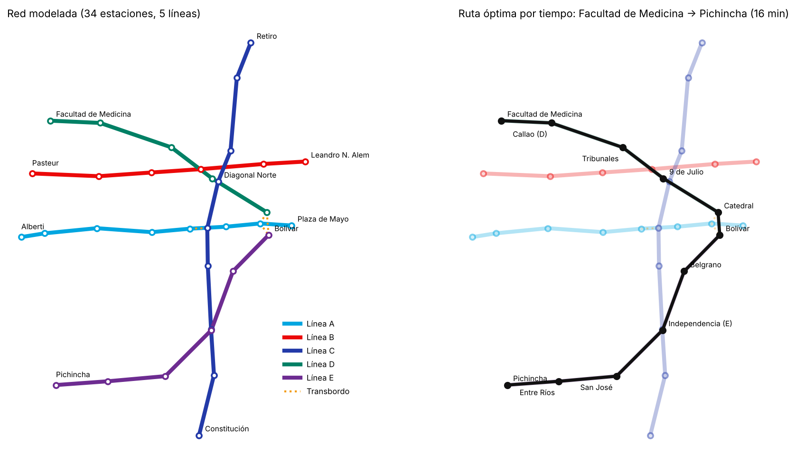

# 🚇 Rutas óptimas en el Subte de Buenos Aires con A\*

Aplicación web que calcula el trayecto óptimo entre dos estaciones del metro de Buenos Aires usando el **algoritmo de búsqueda A\***. Permite elegir si se quiere la ruta **más rápida** o la **más corta**, tiene en cuenta los **transbordos** entre líneas y comprueba el **horario de servicio** según el día y la hora de salida.


> Proyecto de la asignatura **Inteligencia Artificial** (Grado en Ciencia de Datos e Inteligencia Artificial, UPM · curso 2024-25), desarrollado en grupo.



---

## Funcionalidades

- **Ruta óptima con A\*** entre cualquier par de las 34 estaciones modeladas.
- **Dos criterios de optimización:** tiempo de viaje (minutos) o distancia recorrida (metros).
- **Transbordos** entre las 5 líneas, con su coste en tiempo y distancia.
- **Horarios reales de servicio:** laborables, sábados, domingos y festivos de Argentina. La app avisa si el metro está cerrado o si cierra antes de llegar.
- **Hora estimada de llegada** a partir de la fecha y la hora de salida.
- **Mapa interactivo** (Folium + OpenStreetMap) con la red completa y la ruta resaltada.
- **Indicaciones paso a paso**, por ejemplo: *"Línea B de Pasteur a Carlos Pellegrini (3 paradas) → transbordo a 9 de Julio → …"*.

## Cómo funciona

### 1. Modelado de la red como grafo

La red se representa como un **grafo no dirigido** con NetworkX:

| Elemento | Representación |
|---|---|
| Estación | Nodo con sus coordenadas (lat, lon), obtenidas de Google Maps |
| Tramo entre dos estaciones consecutivas | Arista con su **distancia** (m) y su **tiempo** (min) |
| Transbordo | Arista especial entre estaciones de líneas distintas |

Las estaciones que se llaman igual en dos líneas (*Callao*, *Independencia*) son nodos distintos, para que cambiar de línea cuente como un transbordo.

**Distancias.** Se calculan con la **fórmula de Haversine**, que da la distancia entre dos puntos de la superficie terrestre teniendo en cuenta su curvatura.

**Tiempos.** Cada tramo tarda *distancia / velocidad de la línea*. La velocidad comercial media de cada línea se obtiene dividiendo su longitud total (de cabecera a cabecera) entre el tiempo que tarda el tren en recorrerla ([`scripts/calculo_velocidades.py`](scripts/calculo_velocidades.py)):

| Línea | Longitud | Tiempo de recorrido | Velocidad media |
|---|---|---|---|
| A | 8,1 km | 23 min | 21,1 km/h |
| B | 10,2 km | 23 min | 26,7 km/h |
| C | 4,0 km | 13 min | 18,4 km/h |
| D | 10,0 km | 26 min | 23,1 km/h |
| E | 9,3 km | 24 min | 23,3 km/h |

Un transbordo cuesta **2 minutos** (tiempo medio andando entre andenes) y, en el modo distancia, la distancia en línea recta entre las dos estaciones.

### 2. Algoritmo A\*

A\* explora primero los nodos con menor **f(n) = g(n) + h(n)**:

- **g(n):** coste real acumulado desde el origen hasta la estación *n*.
- **h(n):** estimación (heurística) del coste que falta desde *n* hasta el destino.

| Criterio | g(n) | h(n) |
|---|---|---|
| Tiempo | Suma de minutos de los tramos y transbordos recorridos | Distancia en línea recta hasta el destino ÷ velocidad de la línea más rápida (B, 7,41 m/s) |
| Distancia | Suma de metros recorridos | Distancia en línea recta (Haversine) hasta el destino |

Las dos heurísticas son **admisibles**: nunca sobreestiman el coste real, porque ningún trayecto es más corto que la línea recta ni ningún tren va más rápido que la línea más rápida. Por eso **A\* garantiza encontrar la ruta óptima**, y además explora menos nodos que una búsqueda sin heurística (Dijkstra). En media, evalúa un **30 % menos de estaciones** con el criterio de tiempo.

## Estructura del repositorio

```
├── app.py                      # Interfaz web (Streamlit + Folium)
├── metro/                      # Lógica del proyecto, independiente de la interfaz
│   ├── datos.py                # Estaciones, coordenadas, transbordos, velocidades, festivos
│   ├── grafo.py                # Haversine y construcción del grafo
│   ├── astar.py                # Heurísticas y búsqueda A*
│   └── horario.py              # Horarios de servicio y festivos
├── scripts/
│   └── calculo_velocidades.py  # Cálculo de la velocidad media de cada línea
├── tests/
│   └── test_metro.py           # Pruebas automáticas (pytest)
├── notebooks/
│   └── prototipo_astar.ipynb   # Primer prototipo del algoritmo
└── docs/img/                   # Imágenes del README
```

## Instalación y uso

Requiere Python 3.10 o superior.

```bash
git clone https://github.com/antiasande/metro-buenos-aires-astar.git
cd metro-buenos-aires-astar
pip install -r requirements.txt
streamlit run app.py
```

Se abrirá la aplicación en el navegador (`http://localhost:8501`). En el panel lateral eliges origen, destino, criterio, fecha y hora, y pulsas **Calcular ruta**.

También puedes usar el algoritmo directamente desde Python:

```python
from metro import construir_grafo, buscar_ruta

G = construir_grafo()
ruta = buscar_ruta(G, "Pasteur", "Plaza de Mayo", criterio="tiempo")
print(ruta.estaciones)   # ['Pasteur', 'Callao_B', 'Uruguay', 'Carlos Pellegrini', '9 de Julio', 'Catedral', 'Perú', 'Plaza de Mayo']
print(f"{ruta.minutos:.1f} min, {ruta.metros:.0f} m, {len(ruta.transbordos)} transbordos")
```

## Pruebas

```bash
python -m pytest
```

Las pruebas comprueban, entre otras cosas, que:

- las dos heurísticas son **admisibles** para todas las parejas de estaciones;
- A\* devuelve **el mismo coste óptimo que Dijkstra** en los **1.122 pares origen-destino** posibles, con los dos criterios;
- el horario de servicio funciona correctamente en laborables, domingos, festivos y al cierre.

## Revisión posterior a la entrega

Después de la entrega revisé el código para publicarlo, y encontré y corregí estos problemas:

1. **Heurística mal calculada.** Las coordenadas se convertían a radianes dos veces, así que h(n) valía unas 50 veces menos de lo que debía (≈0,13 min en lugar de ≈6,7 min en el trayecto Alberti → Retiro). Las rutas seguían siendo correctas, pero A\* funcionaba prácticamente como Dijkstra, sin aprovechar la heurística.
2. **Heurística no admisible en el modo distancia.** Los transbordos tenían un coste fijo de 10 m, pero algunas estaciones de transbordo están a más de 200 m en línea recta. Ahora el transbordo cuesta la distancia real entre las dos estaciones, y la admisibilidad se comprueba con tests.
3. **Mensajes de la interfaz.** El mensaje de "Ruta calculada con éxito" sobrescribía los avisos de error y el aviso de cierre del metro. Además, ahora se comprueba también que el metro no cierre antes de llegar.
4. **Organización del código.** Había dos versiones de la app casi idénticas (una por tiempo y otra por distancia), de unas 550 líneas cada una. Se han unificado en un paquete `metro/` modular y una única interfaz con selector de criterio, y se han añadido tests automáticos.

## Limitaciones y posibles mejoras

- Solo se modela el tramo de red que indicaba el enunciado (34 estaciones), no la red completa.
- El tiempo de transbordo es un valor medio fijo. Se podría ajustar por estación según la longitud real de los pasillos, las escaleras, etc.
- No se tienen en cuenta las frecuencias de paso ni el tiempo de espera en el andén, que dependen de la hora.
- Los horarios y festivos son una lista fija. Se podrían obtener de los datos abiertos de Buenos Aires (GTFS).

## Autoría

Proyecto realizado en grupo (Grupo 02) para la asignatura de Inteligencia Artificial de la UPM:

- **Antía Sande Fernández** — *[tu parte en el proyecto]*
- *[Compañero/a 2]*
- *[Compañero/a 3]*
- *[Compañero/a 4]*

Revisión, refactorización y tests para la publicación de este repositorio: Antía Sande Fernández (2026).

## Tecnologías

Python · NetworkX · Streamlit · Folium / streamlit-folium · Matplotlib · pytest
